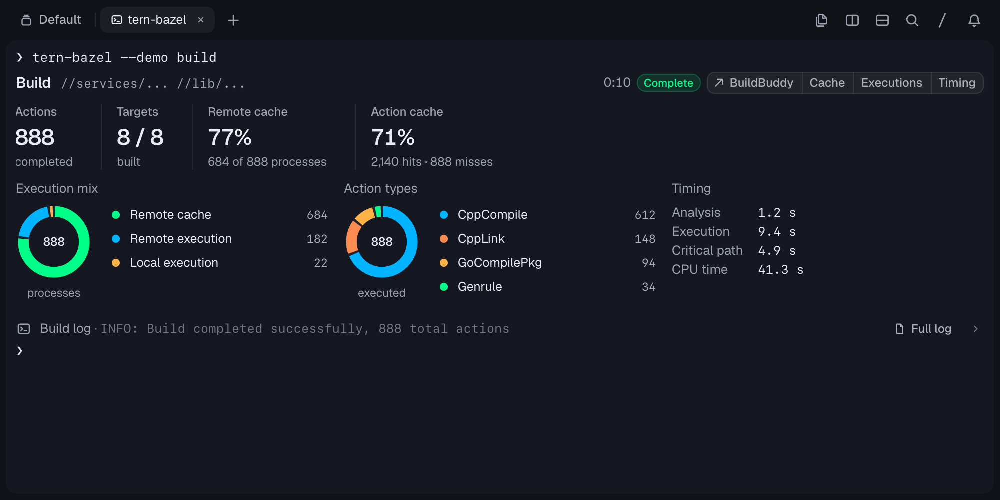
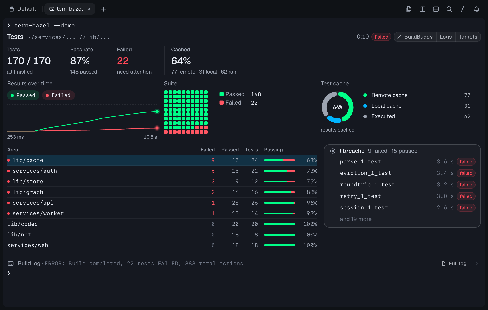

# bazel-tern

Native Bazel build, test, run and query views for [Tern](https://stencil.so/tern). Use your usual `bazel`, `bazelisk`, or `bb` commands—no `.bazelrc` changes required.

[Download the plugin](https://github.com/sgammon/bazel-tern/releases/latest) · [Full guide](docs/usage.md)

<picture>
  <source media="(prefers-color-scheme: light)" srcset="https://raw.githubusercontent.com/sgammon/bazel-tern/main/media/tern-bazel-preview-light.png">
  
</picture>

- **Tests:** pass rate, failures, results over time, the suite as a grid, and failures by area with the tests behind them, live while Bazel is still discovering targets.
- **While building:** action progress and throughput, test results as they report in, and the log folded to its latest line until you open it.
- **On success:** actions, targets and cache tiles, then execution mix, action types, and timings when Bazel reports them.
- **On failure:** the first errors and failed tests in one card, with test logs, the full log and BuildBuddy a click away.
- **`bazel run`:** the same view while the target builds, then one line of facts and the terminal is your program's: its input, colors and exit status.
- **`bazel query` and `cquery`:** results as a table with rule kinds, counts and a breakdown by kind. Piped queries and other `--output` formats print exactly as before.
- **BuildBuddy friendly:** existing BES, authentication, remote execution, and cache settings pass through. Detected invocations get contextual shortcuts.



The layout adapts to the pane. Small panes use one line of metrics and a sparkline; wider panes get tiles and native charts.

## Install

Requires **Tern**, **Node.js 22+ on PATH**, and **zsh** for automatic integration.

Download [`bazel-tern-plugin.tar.gz`](https://github.com/sgammon/bazel-tern/releases/latest/download/bazel-tern-plugin.tar.gz), then:

```sh
tar -xzf bazel-tern-plugin.tar.gz
tern plugin install ./bazel
```

Open a **new Tern tab** and build normally:

```sh
bazel build //...
bazel test //...
bazel run //app:server -- --port 8080
bazel query 'deps(//app:server)'
bb test //...
```

Aliases such as `b='clear && bazelisk'` work. Piped/noninteractive commands pass through unchanged. Use `TERN_TSP=0` to bypass the dashboard. The archive bundles the JavaScript runtime code and SDK; no npm install is needed.

For self-hosted BuildBuddy, `TERN_BAZEL_BUILDBUDDY=1` enables its extra tab shortcuts. See the [guide](docs/usage.md) for shell compatibility, metrics definitions, and limitations.

## Develop

```sh
npm ci
npm test
npm run check
npm run install:plugin
```

Preview without submitting a build:

```sh
npm run demo -- build  # successful build
npm run demo -- run    # build, then a program on the terminal
npm run demo -- query  # query results
npm run demo           # a test suite with failures
npx tsx src/cli.ts --replay events.json test //...  # play back a saved build event file
```

The simulated test demo intentionally exits with status 3. The standalone helper is `tern-bazel`; build it with `npm run build` and use `npm link` to put it on PATH.

Built with the official [Tern TypeScript SDK](https://github.com/stencil-hq/tern-sdk). [Third-party notices](THIRD_PARTY_NOTICES.md).
